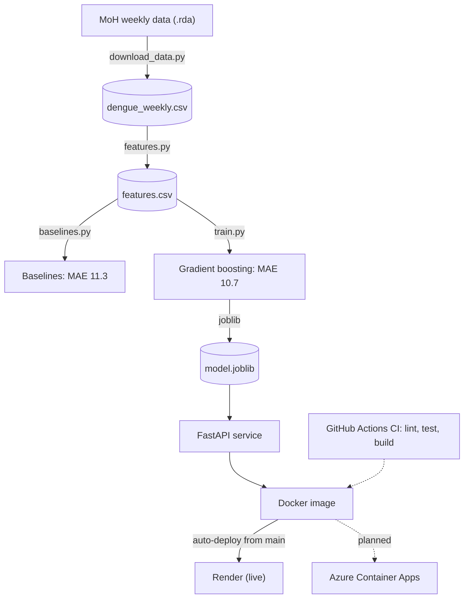
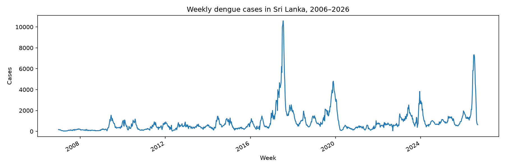
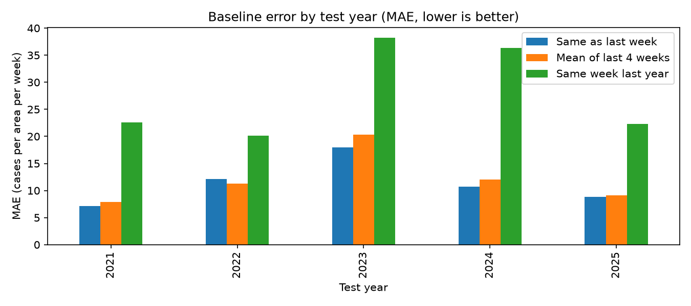
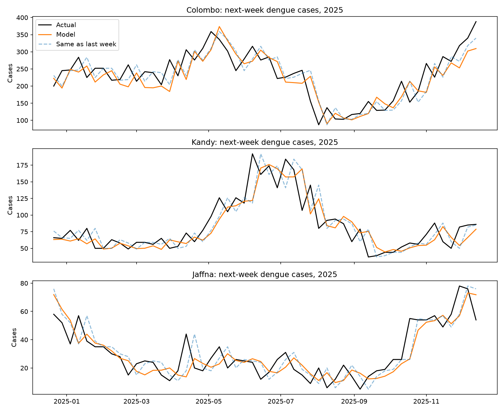
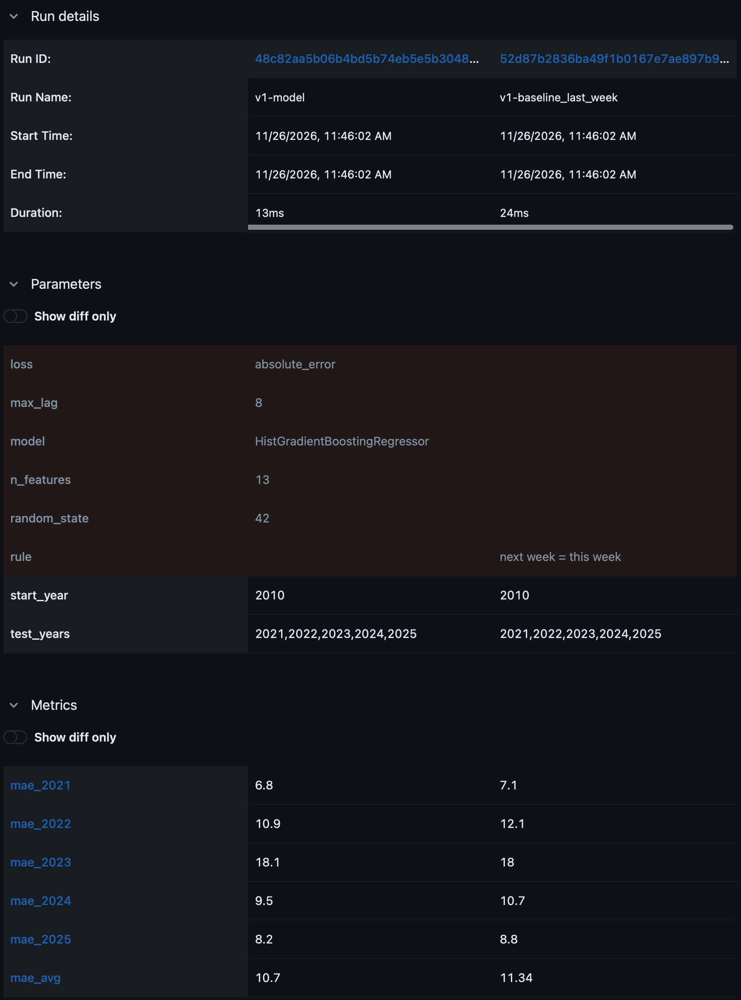
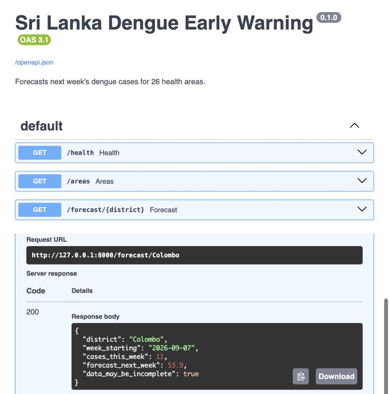

# dengue-early-warning

[](https://github.com/Danishiyan/dengue-early-warning/actions/workflows/ci.yml)

Forecasting next week’s dengue cases for 26 Sri Lankan health areas from Ministry of Health weekly case data (weather planned for v2).

**🌐 Live demo:** [dengue-early-warning-lwgf.onrender.com/docs](https://dengue-early-warning-lwgf.onrender.com/docs) — try `GET /forecast/{area}` in the browser (first request after a quiet period can take ~50 s while the free server wakes up).

> Project 2 of my AI/ML portfolio · v1 deployed on Render · Azure deployment planned.

## Architecture



Solid arrows show data flow (labelled with the script that runs each step); dashed arrows are planned work or checks.

## Problem
Dengue is one of Sri Lanka's biggest public-health problems. Outbreaks follow rain and
temperature with a delay of a few weeks. This project predicts **next week's dengue cases
per health area** so that health teams could act early.

Goals, users, scope, non-goals and risks are in the [product requirements](docs/PRD.md); what the model is for, how it was tested and where it is weaker are in the [model card](docs/MODEL_CARD.md).

## Planned approach
1. ✅ Collect weekly dengue cases per health area (see **Data** below)
2. ⏭️ v2: join weekly weather per district (rainfall, temperature, humidity)
3. ✅ Explore the data (EDA) — see findings below
4. ✅ Build time-series features (lags 1–8, 4-week rolling mean, week-of-year sin/cos) with unit tests
5. ✅ Simple baselines with time-series cross-validation (see **Baselines** below)
6. ✅ Gradient boosting model, evaluated per area (see **Model results** below)
7. ✅ Serve predictions with a FastAPI web service (see **API** below)
8. ✅ Package with Docker (see **Run with Docker** below)
9. ✅ CI with GitHub Actions: Ruff lint, pytest and a Docker build on every push and PR to `main`
10. ✅ Deploy to the cloud: live on Render (see **Deployment** below); Azure Container Apps planned

## Data
| | |
|---|---|
| **Source** | Weekly Epidemiological Reports, Epidemiology Unit, Ministry of Health, Sri Lanka — in tidy form via the [denguedatahub](https://github.com/thiyangt/denguedatahub) R package by Thiyanga Talagala (GPL-3) |
| **Coverage** | Week 52 of 2006 → week 37 of 2026 (weekly) |
| **Areas** | 26 health areas: the 25 districts + Kalmunai (a separate regional health area) |
| **Size** | 26,753 rows · columns `year, week, start_date, end_date, district, cases` |
| **Quality checks** | 0 missing values · 0 duplicate (year, week, area) rows · two date formats in the source, unified while loading |

The data is **not stored in this repo**. One command downloads it and converts it to CSV:

```bash
pip install -r requirements.txt
python -m src.download_data
# -> data/raw/srilanka_weekly_data.rda (original)
# -> data/raw/dengue_weekly.csv       (tidy CSV)
```

## Key findings from exploration (EDA)
Full analysis: [`notebooks/01_eda.ipynb`](notebooks/01_eda.ipynb)



- **Outbreaks vary hugely by year:** 2017 was the worst (174,687 cases, >10,000 in one week). 2006–2008 look under-reported and the latest weeks are incomplete, so training will use 2010 onwards.
- **Two seasons a year:** cases peak in Jan–Feb and Jun–Aug, following Sri Lanka's two monsoons.
- **Areas peak at different times:** Jaffna peaks only in January (north-east monsoon); Colombo and Kandy peak in July (south-west monsoon) → the model needs area-specific features.
- **Very uneven burden:** Colombo alone has 21.9% of cases and the top 3 areas 43% → errors are evaluated per area.
- **Recent weeks are the best predictors:** autocorrelation is 0.96 at 1 week and 0.79 at 4 weeks but only 0.07 at 52 weeks → lags of 1–8 weeks as features; weather will be added to predict outbreak size.


## Baselines
Every model must beat these simple forecasts. Evaluated with **expanding-window time-series cross-validation**: train on all earlier years, test on one year (2021–2025), so the model never sees the future.

| Baseline | Rule | MAE (avg 2021–2025) |
|---|---|---|
| Same as last week | next week = this week | **11.3** |
| Mean of last 4 weeks | average of the last 4 weeks | 12.1 |
| Same week last year | value 52 weeks earlier | 27.9 |

MAE = mean absolute error in cases per area per week (lower is better). "Same as last week" is the bar the ML model has to beat.



```bash
python -m src.features    # build data/processed/features.csv
python -m src.baselines   # print baseline MAE, save chart + reports/baseline_results.csv
python -m pytest -v       # run unit tests
```

## Model results
**Model:** scikit-learn `HistGradientBoostingRegressor` trained with absolute-error loss on: this week's cases, lags 1–8, 4-week rolling mean, week-of-year (sin/cos) and area. Same time-series cross-validation as the baselines.

| Test year | Baseline (same as last week) | Model |
|---|---|---|
| 2021 | 7.1 | **6.8** |
| 2022 | 12.1 | **10.9** |
| 2023 | **18.0** | 18.1 |
| 2024 | 10.7 | **9.5** |
| 2025 | 8.8 | **8.2** |
| **Average** | 11.3 | **10.7** (5.6% lower error) |

**Per area (2025):** the model beats the baseline in **23 of 26 areas**. It does **not** in Trincomalee (by a small margin) or in the two largest, Colombo and Gampaha, where it under-predicts fast-rising outbreaks (details: `reports/error_by_area_2025.csv`).



**What I learned:** the first model was ~15% *worse* than the baseline because this week's cases were missing from the features and the training loss (squared error) didn't match the reported metric (MAE). Fixing both made it beat the baseline. A unit test now guards the feature list.

**Limitations:** gains are modest (5.6%); case history alone can't anticipate sudden outbreaks in big areas. Next step (v2): add rainfall and temperature, and try predicting % change for large areas. Retraining on Linux (Docker/CI) gives about 6.0% instead of 5.6%. Data, library versions and `random_state=42` are the same on both, so the most likely cause is small floating-point differences between platforms; results repeat exactly on the same platform.

```bash
python -m src.train      # cross-validation + save models/model.joblib
python -m src.evaluate   # per-area errors + forecast chart for 2025
```

## Experiment tracking
Every cross-validation result is logged to **MLflow** (an open-source tool that records each training run's settings and scores), so a future change, such as adding weather in v2, can be compared with v1 run by run instead of by memory.

- One run per method: `v1-baseline_last_week` and `v1-model`
- **Parameters:** only the settings each method really used (the baseline logs just its rule, start year and test years)
- **Metrics:** MAE for each test year (2021–2025) and the average

```bash
pip install -r requirements-dev.txt
python -m src.experiment                                   # log both runs
mlflow ui --backend-store-uri sqlite:///mlruns/mlflow.db   # open http://127.0.0.1:5000
```



Runs are stored locally in `mlruns/` (not in Git).

## API
A FastAPI service returns a one-week-ahead forecast for any of the 26 areas.

```bash
python -m src.train                 # creates models/model.joblib (once)
uvicorn src.api:app --reload        # start the API
```
Then open **http://127.0.0.1:8000/docs** for interactive documentation.



| Endpoint | Returns |
|---|---|
| `GET /health` | `{"status": "ok"}` (used by the cloud and the CI smoke test to check the app is alive) |
| `GET /areas` | The 26 area names |
| `GET /forecast/{area}` | The latest fully reported week and the forecast for the week after it |

Example: `GET /forecast/colombo`
```json
{
  "district": "Colombo",
  "based_on_week": "2026-08-10",
  "cases_that_week": 584,
  "forecast_week_starting": "2026-08-17",
  "forecast_cases": 488.3,
  "weeks_still_being_reported": 4
}
```
The newest 4 weeks are still being reported, so their counts are too low (found in the EDA). The API forecasts from the latest **complete** week instead, so a partly reported week never looks like a sudden drop or outbreak. Before this change, the same request used the partly reported week of 7 Sep (11 cases) and forecast 50.5, far below the real level.

## Run with Docker
The image runs the whole pipeline at build time (download data → build features → train model),
so it starts with fresh data and a trained model inside. Nothing needs to be installed except Docker.

```bash
docker build -t dengue-api .                       # ~4 min first time (downloads packages + data, trains)
docker run --rm -p 8000:8000 dengue-api            # start the API
curl http://localhost:8000/health                  # {"status":"ok"}
curl http://localhost:8000/forecast/colombo
```
Then open **http://localhost:8000/docs**. Stop with `Ctrl+C`.

- Base image `python:3.12-slim`, runtime packages only (`requirements.txt`), runs as a non-root user.
- Image size: ~865 MB (mostly pandas, scikit-learn, scipy and matplotlib).
- Rebuilding the image re-downloads the data and retrains the model, which makes it the way to refresh forecasts.
- CPU threads are limited to 1 (`OMP_NUM_THREADS`, `LOKY_MAX_CPU_COUNT`) so training doesn't stall on small cloud CPUs (see **Deployment**).

## Deployment
The same Docker image is deployed to **Render** (free web service, Singapore region):

| | |
|---|---|
| **Live URL** | https://dengue-early-warning-lwgf.onrender.com/docs |
| **Deploys** | Automatically on every merge to `main` (after CI passes on the PR) |
| **Health check** | Render calls `GET /health` and only switches traffic to a new version that answers it |
| **Port** | Read from the `PORT` variable the platform sets (8000 locally) |
| **Free-tier limits** | 0.1 CPU, 512 MB RAM; sleeps after inactivity, so the first request can take ~50 s |

**Deployment bug I fixed:** the first cloud build froze for 16 minutes while training, although the same Dockerfile trains in seconds in CI. Small cloud containers report the host machine's CPU count, not their own small share, so scikit-learn's OpenMP started many threads that fought over a fraction of one CPU. Setting `OMP_NUM_THREADS=1` and `LOKY_MAX_CPU_COUNT=1` in the Dockerfile fixed it: the build now takes about 1.5 minutes.

**Next:** deploy the same image to Azure Container Apps (no code changes needed, since the port comes from `PORT`).

## Project structure
```
data/
  raw/          # original downloaded data (not in Git)
  external/     # extra sources, e.g. weather (not in Git)
  processed/    # cleaned, joined data (not in Git)
notebooks/      # exploration
src/            # project code
tests/          # automated tests
configs/        # settings (config.yaml: paths, data, evaluation, model, logging)
docs/           # product requirements (PRD) and model card
models/         # trained models (not in Git)
mlruns/         # MLflow experiment runs (not in Git)
reports/figures # charts
```

## Licence
MIT
