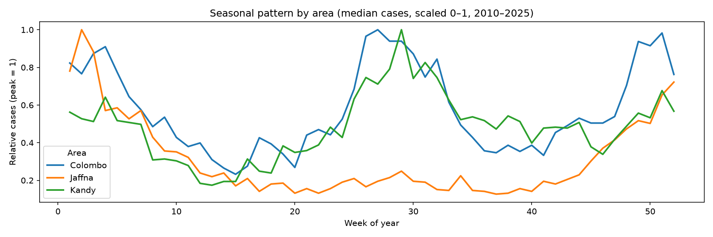

# dengue-early-warning

Forecasting weekly dengue risk for Sri Lankan districts from case and weather data.

> 🚧 Work in progress — Project 2 of my AI/ML portfolio.

## Problem
Dengue is one of Sri Lanka's biggest public-health problems. Outbreaks follow rain and
temperature with a delay of a few weeks. This project predicts **next weeks' dengue cases
per district** so that health teams could act early.

## Planned approach
1. ✅ Collect weekly dengue cases per district (see **Data** below)
2. Join weekly weather per district (rainfall, temperature, humidity)
3. ✅ Explore the data (EDA) — see findings below
4. ✅ Build time-series features (lags 1–8, 4-week rolling mean, week-of-year sin/cos) with unit tests
5. ✅ Simple baselines with time-series cross-validation (see **Baselines** below) → then train ML models
6. Serve predictions with an API, package with Docker, deploy to Azure

## Data
| | |
|---|---|
| **Source** | Weekly Epidemiological Reports, Epidemiology Unit, Ministry of Health, Sri Lanka — in tidy form via the [denguedatahub](https://github.com/thiyangt/denguedatahub) R package by Thiyanga Talagala (GPL-3) |
| **Coverage** | Week 52 of 2006 → week 37 of 2026 (weekly) |
| **Areas** | 26 health areas: the 25 districts + Kalmunai (a separate regional health area) |
| **Size** | 26,753 rows · columns `year, week, start_date, end_date, district, cases` |
| **Quality checks** | 0 missing values · 0 duplicate (year, week, area) rows · two date formats in the source, unified while loading |

The data is **not stored in this repo**. One command downloads it and converts it to CSV:

```bash
pip install -r requirements.txt
python -m src.download_data
# -> data/raw/srilanka_weekly_data.rda (original)
# -> data/raw/dengue_weekly.csv       (tidy CSV)
```

## Key findings from exploration (EDA)
Full analysis: [`notebooks/01_eda.ipynb`](notebooks/01_eda.ipynb)


- **Outbreaks vary hugely by year:** 2017 was the worst (174,687 cases, >10,000 in one week). 2006–2008 look under-reported and the latest weeks are incomplete, so training will use 2010 onwards.
- **Two seasons a year:** cases peak in Jan–Feb and Jun–Aug, following Sri Lanka's two monsoons.
- **Areas peak at different times:** Jaffna peaks only in January (north-east monsoon); Colombo and Kandy peak in July (south-west monsoon) → the model needs area-specific features.
- **Very uneven burden:** Colombo alone has 21.9% of cases and the top 3 areas 43% → errors are evaluated per area.
- **Recent weeks are the best predictors:** autocorrelation is 0.96 at 1 week and 0.79 at 4 weeks but only 0.07 at 52 weeks → lags of 1–8 weeks as features; weather will be added to predict outbreak size.



## Baselines
Every model must beat these simple forecasts. Evaluated with **expanding-window time-series cross-validation**: train on all earlier years, test on one year (2021–2025), so the model never sees the future.

| Baseline | Rule | MAE (avg 2021–2025) |
|---|---|---|
| Same as last week | next week = this week | **11.3** |
| Mean of last 4 weeks | average of the last 4 weeks | 12.1 |
| Same week last year | value 52 weeks earlier | 27.9 |

MAE = mean absolute error in cases per area per week (lower is better). "Same as last week" is the bar the ML model has to beat.


```bash
python -m src.features    # build data/processed/features.csv
python -m src.baselines   # print baseline MAE, save chart + reports/baseline_results.csv
python -m pytest -v       # run unit tests
```

## Project structure
```
data/
  raw/          # original downloaded data (not in Git)
  external/     # extra sources, e.g. weather (not in Git)
  processed/    # cleaned, joined data (not in Git)
notebooks/      # exploration
src/            # project code
tests/          # automated tests
configs/        # settings (paths, districts, parameters)
models/         # trained models (not in Git)
reports/figures # charts
```

## Licence
MIT
